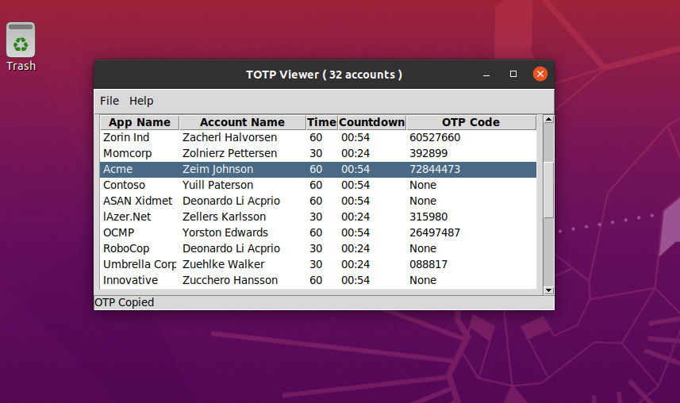
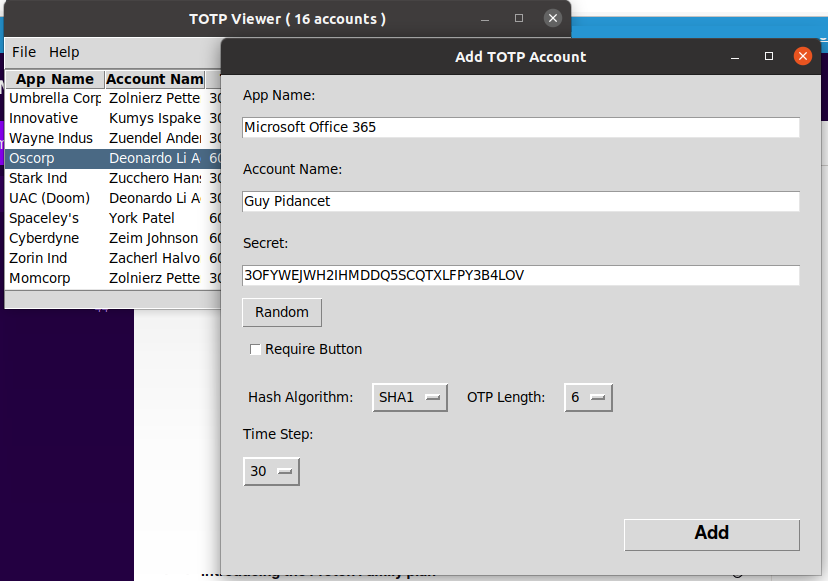
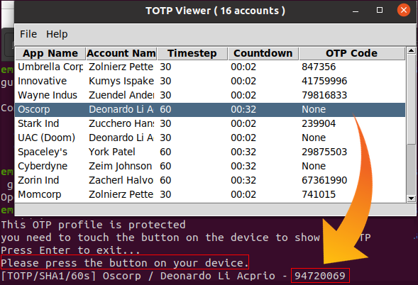

# Token2 OTP CLI Tool

[](https://www.python.org/)
[]()
[](LICENSE)

A command-line tool (with an optional desktop GUI) for managing TOTP/HOTP
entries stored **on-device** on Token2 T2F2 / PIN+ hardware security keys —
over USB or NFC/PC-SC.

> ⚠️ **Security note:** TOTP/HOTP are shared-secret OTP schemes and are **not
> phishing-resistant**. Wherever a service supports it, prefer **FIDO2 /
> WebAuthn**. This tool exists to manage OTP seeds for services that don't yet
> support FIDO2. See [Security](#-security) below and the
> [protocol reference](docs/Token2-OTP-SDK-Protocol.md) for details.

---

## ✨ Features

- 🔐 Read, write, update, and delete TOTP/HOTP entries directly on the device
- 📋 List all stored entries and generate current OTP codes
- 🔑 Configure a HOTP code that's typed via keyboard emulation on physical
  button press
- 🛰️ Works over **USB-HID** or **PC/SC (NFC / smart-card readers)** — auto-detected
- 🧮 Supports SHA1/SHA256, 6–10 digit codes, configurable TOTP time-step
- 🖱️ "Button required" flag for an extra confirmation step on sensitive entries
- 🖥️ Optional **Tkinter GUI** (TOTP Viewer): live-updating table, clipboard copy,
  add/delete accounts, test-account generator
- 🔒 **OTP PIN (privacy protection)**: set / verify / change / remove / lock /
  status, with client-side PIN-policy validation (**only for devices running firmware R3.4 or later**)
- 🧾 JSON output mode (`--json`) for scripting and automation
- 📚 Full wire-protocol documentation for building your own integrations

---

## 📦 Installation

### 1. Platform setup

**Linux**

```bash
# Allow USB access without sudo
echo 'SUBSYSTEM=="usb", ATTR{idVendor}=="349e", ATTR{idProduct}=="0022", MODE="0660", GROUP="plugdev", TAG+="uaccess", TAG+="udev-acl"' \
  | sudo tee /etc/udev/rules.d/99-token2.rules
sudo udevadm control --reload-rules && sudo udevadm trigger

# Build dependencies for hidapi / pyscard
sudo apt-get update
sudo apt-get install -y swig build-essential libpcsclite-dev pcscd

# Optional: required for the GUI (TOTP Viewer)
sudo apt-get install -y python3-tk xclip
```

**macOS**

```bash
brew install swig
```

**Windows**

No additional setup required.

### 2. Install the project

```bash
git clone https://github.com/<your-org>/token2-otp-cli.git
cd token2-otp-cli

python3 -m venv venv
source venv/bin/activate      # On Windows: venv\Scripts\activate

pip install -r requirements.txt
```

> **macOS note:** if you get device-access (`OSError`) issues, try running
> with `sudo`.

---

## 🚀 Usage

### Plug in your device

- **NFC:** plug in a PC/SC-compatible (USB NFC) reader with up-to-date drivers
  and place the token on it.
- **USB:** plug the Token2 key directly into a USB port.

### General help

```bash
python3 app.py --help
```

### CLI commands

#### List all OTP entries

Entries that require a button press (or are HOTP) are listed but their code
is masked — use `read_entry` to retrieve those.

```bash
python3 app.py get_all
```

#### Read a single entry

If the entry is HOTP, or has the "button required" flag set and you're on
USB, the command waits until you press the button on the device.

```bash
python3 app.py read_entry --app-name "Test app" --account-name "Test account"
```

#### Add or update an entry

If an entry with the same `app-name`/`account-name` already exists, it is
overwritten.

```bash
python3 app.py write_entry \
  --app-name "Test app" --account-name "Test account" \
  --seed JBSWY3DPEHPK3PXPJBSWY3DPEHPK3PXP
```

With explicit options:

```bash
python3 app.py write_entry \
  --type TOTP --algorithm SHA1 --timestep 30 --code-length 6 \
  --button-required \
  --app-name "Test app" --account-name "Test account" \
  --seed JBSWY3DPEHPK3PXPJBSWY3DPEHPK3PXP
```

#### Delete an entry

```bash
python3 app.py delete_entry --app-name "Test app" --account-name "Test account"
```

#### Erase **all** entries

> ⚠️ **Destructive** — permanently deletes every seed stored on the token.

```bash
python3 app.py erase_all
```

#### Configure the button-press HOTP code

```bash
python3 app.py set_btn_seed --code-length 6 --seed ABCABCAA --short-touch
```

#### Remove the button-press HOTP code

```bash
python3 app.py delete_btn_seed
```

#### Read the device's serial number

Only PIN+ series keys have the serial number printed on the case.

```bash
python3 app.py read_serial_no
```

#### OTP PIN (privacy protection)

The OTP PIN gates read access to stored codes. Set it once, then verify to open
a read window before listing codes.

```bash
# Show whether a PIN is set
python app.py pin_status

# Set a PIN (only when none is set yet)
python app.py set_pin --pin 3219918

# Verify to open the read window, then read codes
python app.py verify_pin --pin 3219918
python app.py get_all --pin 3219918

# Change or remove the PIN
python app.py change_pin --old-pin 3219918 --new-pin 4820571
python app.py remove_pin --pin 4820571

# End the verified window immediately
python app.py lock_pin
```

**PIN policy.** The firmware rejects weak PINs; the CLI validates client-side
first and explains why. Numeric PINs must be ≥ 6 digits and must not be
sequential (`123456`/`654321`), all-identical (`111111`), palindromes
(`321123`), or contain a digit more than 3 times (`111123`). Alphanumeric PINs
must be ≥ 10 characters using at least two of {upper, lower, digit, special}.

**Transport.** PIN commands run over PC/SC by default. Direct CCID-over-USB is
also available with `--transport apdu-hid` (needs a libusb backend, and on
Windows a WinUSB binding on the CCID interface).

**Reset.** There's no PIN-only reset. `remove_pin` clears a PIN you know;
`erase_all` wipes all OTP data and PIN state (use it to recover a locked PIN).

### Scripting / JSON output

Add `--json` to any command for machine-readable output, e.g.:

```bash
python3 app.py --json get_all
```

---

## 🖥️ GUI (TOTP Viewer)

A Tkinter-based desktop viewer is included in `gui/`. It wraps the CLI to
provide a live-updating table of your OTP codes.

### Run it

```bash
# From the project root (so it can find app.py)
python3 gui/ui.py
```

### Features

- Live table of all entries with countdown timers per TOTP time-step
- Double-click a code to copy it to the clipboard
- Entries protected with "button required" show `None` until you double-click
  and confirm on the device — the code is then printed in a console window
- **File → Add Account** — add a new TOTP entry via a form, with a "Random"
  secret generator
- **File → Delete Account** — remove the selected entry
- **File → Erase All Accounts** — wipe the device (with confirmation)
- **File → Generate Test Accounts** — populate the device with sample entries
  for testing (don't use this on a device with real accounts!)

### Screenshots

| Account list | Add account | Button-protected OTP |
|---|---|---|
|  |  |  |

---

## 📡 Protocol reference

The full wire-protocol specification — APDU framing, USB-HID/PC-SC transport
details, command set, ECDH+AES seed encryption, validation rules, and
end-to-end traces — is documented in:

➡️ **[docs/Token2-OTP-SDK-Protocol.md](docs/Token2-OTP-SDK-Protocol.md)**

This is enough to implement a compatible client in another language.

---

## 🛡️ Security

- This tool manages **TOTP/HOTP shared secrets**. Anyone who can read a seed
  (from the provisioning channel, a backup, or a leaked QR code) can generate
  valid codes indefinitely. Treat seeds as sensitive credentials.
- Seed-writing commands are encrypted on the wire using **ephemeral ECDH
  (NIST P-256) + AES-CBC**, per the protocol document — but the host-side
  secrets you type on the command line may still be visible in shell history
  or process listings. Prefer the GUI's random-secret generator, or pipe
  seeds in from a secure source where possible.
- `erase_all` and `set_btn_seed`/`delete_btn_seed` are **destructive /
  device-altering** operations. Always double-check the device you're
  targeting.
- **Prefer FIDO2/WebAuthn** over TOTP/HOTP wherever the relying party
  supports it — see the warning at the top of the protocol document for why.
- If you build a tool that speaks raw APDUs against this protocol, read
  the **"Hardware-safety warning"** in the protocol document before sending
  any device-configuration commands — some configurations can leave the
  device unable to be communicated with at all.

---

## 🤝 Contributing

Contributions, bug reports, and feature requests are welcome! Please see
[CONTRIBUTING.md](CONTRIBUTING.md) for guidelines.

## 📄 License

This project is licensed under the [MIT License](LICENSE).

## 📬 Support

For questions about Token2 hardware, contact Token2 support. For issues with
this tool itself, please open a GitHub issue.
